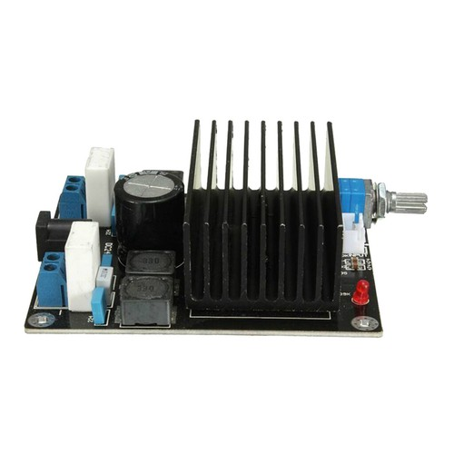
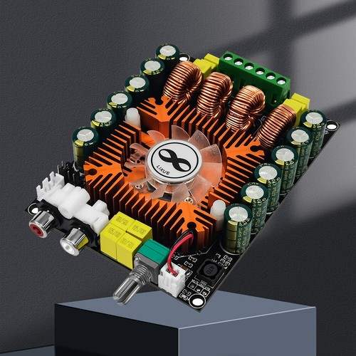
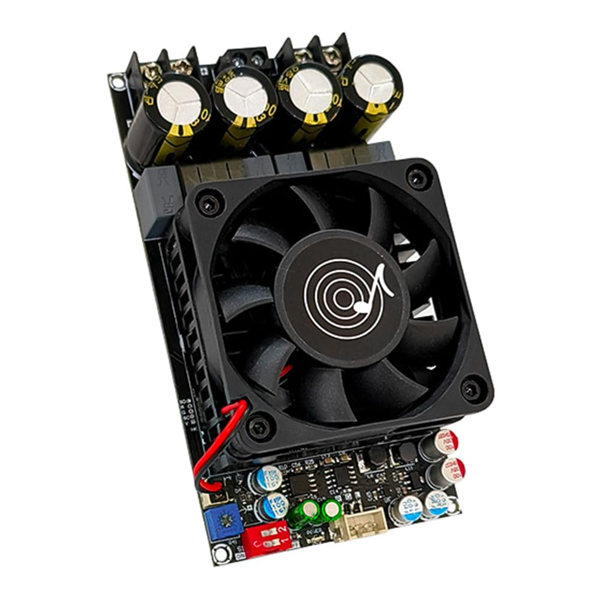

+++
title = 'Battery Powered Bass Amp'
date = 2026-10-18T16:25:37+01:00
draft = true
+++

I've been meaning to write this up for several years now, but I've finally got a project that's worth writing up.

The project would also work well for an ordinary (6-string) electric or electro-acoustic guitar, but you might want a fancier preamp to include EQ, FX send-return etc. Also the higher power output for bass kind of drove the project direction.

# Summary
- Run time  of tens of hours - long enough for multiple gigs between charges
- Uses easily available Li-Ion battery packs
- Drives 8 ohm speaker loads (at ~70 watts) or 4 ohm speaker loads (at ~140 watts)
- Runs cool enough that the fan hardly comes on

At the end I've included notes on previous iterations, which were lower powered and used less good modules.

# How does it sound?

At low settings, it sounds pretty neutral/clean. You can dial in a bit of soft-clipping dirt using higher gain settings of the preamp.

This is very much down to the speaker cabs that you use it with. A single small, fairly sensitive cabinet such as a [Barefaced One10](https://barefacedaudio.com/products/one_10) goes loud enough to accompany a big-band with a drum kit.

If you need to go louder, it can drive a second One10, wired in parallel (twice the effective watts). Or switch up to a bigger more sensitive cab.

> [!TIP] The +3 dB rule
> Decibels are logarithmic. To get a noticeable, significant jump in volume (+10 dB, which sounds roughly "twice as loud" to human ears), you actually need _10 times the amplifier wattage_ which is infeasible.
>
> Doubling the amp output watts only nets you a +3 dB increase, which humans hear as _slightly louder_.

So, if you want to go louder, it's better to use [more efficient cabs than increasing amp watts](https://barefacedaudio.com/pages/amp-vs-cab-power).

# Batteries

I chose Milwaukee 18v 6Ah battery packs as I already used them in power tools. (Aftermarket cheaper compatible ones are available on eBay, although folks tell me they are not as good as genuine ones). The packs have charge status LEDs. Aftermarket adapters (with trailing wires) are also available on eBay.

> [!CAUTION] Fuses
> Fuses should be as close as possible to the source of the power. My build puts the fuses in chassis-mounted holders. It would be better to have them upstream in the battery clips, but I didn't have room. My battery packs have over-current/overload, over-discharge (low voltage), and overheating protection. It's worth checking this on packs you intend to use.

# Power supply

# Preamp

# Power amp

# Buffer stage

# Mechanical construction

# Measurement

# Previous iterations

First version, 2019: TDA7498 module. The module I purchased was limited to 36v absolute max. Fully-charged 18v batteries can reach >20v, so this limited the project to a single battery.

Second version: TDA7498E. This uprated version has a fan (which hardly ever comes on) and was only £12. It can handle higher supply rail voltages. Unfortunately the one I purchased only had one working channel, so I was unable to try out bridge mode. This can happen with cheap eBay modules sometimes.

Third version: TPA3255. This can handle supply rail voltages up to 50v, and is happy with 4 ohm loads.

About £23 from [Amazon](https://www.amazon.co.uk/dp/B0CPP72CQR) at time of writing,in 2026 for the ZK-3002 Dollatek branded / Wuhzi Audio board. It's a bit bigger than the previous modules - it's longer, and also higher with a more substantial fan. This required some mechanical rearranging inside the amp box. It came with a [downloadable instruction manual](img/New%20power%20amp%20module%20-%20ZK-3002ins.pdf), English starts on pp. 11. This gives useful details of input gain setting and bridge (PBTL) mode.
