+++
title = 'Battery Powered Bass Amp'
date = 2026-10-18T16:25:37+01:00
draft = true
+++

I've been meaning to write this up for several years now, but I've finally got a version of this project that's worth writing up.

The project would also work well for an ordinary (6-string) electric or electro-acoustic guitar, but you might want a preamp with EQ, FX send-return etc. Simplicity, and the need for for bass to have higher power output drove this project direction.

# Requirements
- Run time  of tens of hours - long enough for multiple gigs between charges
- Uses easily available Li-Ion battery packs
- Based on off-the-shelf Class D power amp module
- Goes loud enough for medium-sized gigs

## Nice-to-haves
- Drives 8 ohm speaker loads (at ~70 watts) or 4 ohm speaker loads (at ~140 watts)
- Runs cool enough that the fan hardly comes on

At the end I've included notes on previous iterations, which were lower powered with less-capable modules.

# How does it sound?

At low settings, it sounds pretty neutral/clean. The preamp can give a bit of soft-clipping dirt at higher gain settings.

Sound level is very much down to the speaker cabs that you use it with. A single small, fairly sensitive cabinet such as a [Barefaced One10](https://barefacedaudio.com/products/one_10) goes loud enough to accompany a big-band with a drum kit.

If you need to go louder, The One10 is 8 ohms, so you can add a second One10 in parallel (giving twice the effective watts into an overall 4 ohm load). Or switch to a bigger more sensitive cab.

> [!TIP] The +3 dB rule
> Decibels are logarithmic. To get a noticeable, significant jump in volume (+10 dB, which sounds roughly "twice as loud" to human ears), you actually need _10 times the amplifier wattage_ which is infeasible.
>
> Doubling the amp output watts only nets you a +3 dB increase, which humans hear as _slightly louder_.

So, if you want to go louder, it's better to use [more sensitive (efficient) cabs than increasing amp watts](https://barefacedaudio.com/pages/amp-vs-cab-power).

# Batteries

I chose Milwaukee 18v 6Ah battery packs as I already used them in power tools. (Aftermarket cheaper compatible ones are available on eBay, although folks tell me they are not as good as genuine ones). The packs have charge status LEDs. Aftermarket adapters (with trailing wires) are also available on eBay.

# Power supply

> [!CAUTION] Fuses
> Fuses should be as close as possible to the source of the power. My build puts the fuses in chassis-mounted holders. It would be better to have them upstream in the battery clips, but I didn't have room. My battery packs have over-current/overload, over-discharge (low voltage), and overheating protection. It's worth checking this on packs you intend to use.

This allows operation from either one or two 18v batteries.

_MORE_

# Preamp

This is the Jack Orman [AMZ Mosfet Booster](http://www.muzique.com/schem/mosfet.htm) circuit, built on strip board. It's tiny, and light enough that it can just hang off the back of the gain potentiometer inside the case.

This is mostly unchanged through the versions of this amp. As the project evolved, I added an LM317 regulator to give a steady 12v rail for the preamp, and made R2 adjustable to set the bias point. This adjustment allows for maximum dynamic range, with the onset of clipping at upper and lower output voltage swings to be roughly the same.

# Power amp

TPA3255 module. This can handle supply rail voltages up to 50v, and is happy with 4 ohm loads. It claims to produce 300W+300W, but that's only possible with the maximum 50v supply voltage rails.

About £23 from [Amazon](https://www.amazon.co.uk/dp/B0CPP72CQR) at time of writing,in 2026 for the ZK-3002 Dollatek branded / Wuhzi Audio board. It's a bit bigger than the previous modules - it's longer, and also higher with a more substantial fan. This required some mechanical rearranging inside the amp box. It came with a [downloadable instruction manual](img/New%20power%20amp%20module%20-%20ZK-3002ins.pdf), English starts on page 11. There's also an English manual I found [here](https://manuals.plus/asin/B0CPP72CQR).

In bridge mode the right and left output channels are parallelled together, allowing the output stages to provide shared current. It supports tougher theoretical speaker loads down to 2 ohms.

Initial tests showed that, into speaker dummy loads, I was getting nowhere near the expected power output. The The MOSFET booster preamp cannot provide enough current to drive the power amp input properly. A buffer stage between preamp and power amp is necessary.

# Buffer stage

Any basic op-amp will work in this circuit; I used a [TL071](https://www.ti.com/lit/ds/symlink/tl071.pdf) which has low input bias current and  quite good output swing.

This shows a 9v rail, but it works fine on 12v too.

C4 provides DC blocking on the input. This is connected directly to point A of the MOSFET booster, i.e. skipping its own output decoupling cap. 

# Measurement

A 1KHz input tone (cyan) gives clean output maximum swing of nearly 8v pk-pk (yellow).

Playing the bass guitar open G string on the input shows that there is plenty of gain available from the preamp and buffer.

Here's a [simple Python program](https://github.com/tuck1s/rigol) used to capture traces from the Rigol scope over the LAN, without that [tedious mucking about with](https://hitchhikers.fandom.com/wiki/Infinite_Improbability_Drive) ancient USB sticks.

# Mechanical construction

_MORE_

# Previous iterations

First version, 2019: TDA7498 module. The module I purchased was limited to 36v absolute max. Fully-charged 18v batteries can reach >20v, so this limited the project to a single battery.

Second version: TDA7498E. This uprated version has a fan (which hardly ever comes on) and was only £12. It can handle higher supply rail voltages. Unfortunately the one I purchased only had one working channel, so I was unable to try out bridge mode. This can happen with cheap eBay modules sometimes.

Third version: TPA3255.